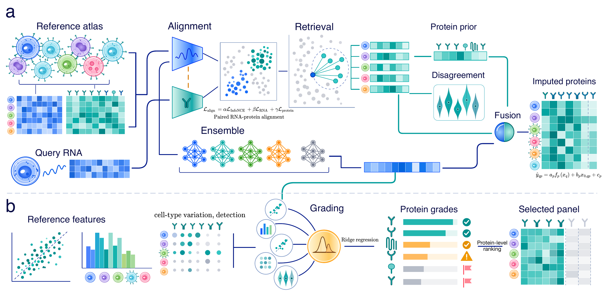
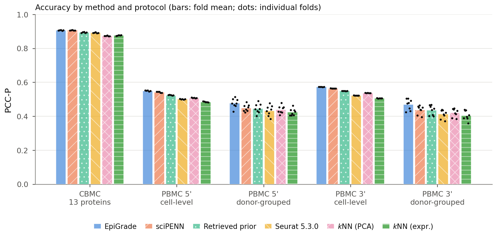

# EpiGrade

Surface-protein imputation from single-cell transcriptomes, graded per protein.

Given a CITE-seq reference atlas with paired RNA and antibody-derived tag (ADT)
measurements and a query cohort profiled by scRNA-seq alone, EpiGrade

1. learns a transcriptome representation aligned to protein variation
   (contrastive zero-inflated negative binomial autoencoder);
2. retrieves the nearest reference cells and forms a similarity-weighted prior
   from their **measured** protein, together with the neighbours' per-protein
   disagreement;
3. trains an ensemble of five transcriptome networks (the sciPENN architecture)
   and fuses it with the prior protein by protein, with weights fitted on
   reference cells the retrieval encoder never saw;
4. grades every protein of the panel from reference-side and retrieval
   descriptors, so that a user can report the subpanel the imputation supports.



*(a) Imputation: aligned RNA and protein encoders, retrieval of a protein prior
and per-protein disagreement, an ensemble of transcriptome networks, and
per-protein fusion. (b) Grading: reference-side descriptors and neighbour
disagreement are mapped to a grade for each protein, which selects the panel
that is reported.*

## Results

On identical folds of three CITE-seq datasets, EpiGrade improves per-protein
correlation (PCC-P) over sciPENN, anchor-based reference mapping (Seurat 5.3.0)
and nearest-neighbour transfer, and keeps its lead under donor-grouped
cross-validation, where no query cell is predicted from its own donor. It is
level with sciPENN on the 13-antibody CBMC panel.



This repository contains the code, the SLURM jobs and the analysis scripts that
produce every number, table and figure of the accompanying paper. Processed
data, folds and run outputs are deposited on Figshare (see [Data](#data)).

## Repository layout

```
code/
  epigrade/       the package: aligner, retrieval, fusion, reliability, metrics
  experiments/    runners (run_fused.py, run_epigrade.py, run_baselines.py,
                  run_cross_cohort_epigrade.py, run_annotation.py) and the
                  analysis and figure scripts
  external/       workers for sciPENN, totalVI and Seurat, run in their own
                  environments
  configs/        fused.yaml (the model), epigrade.yaml (previous design)
  tests/          unit tests
  scripts/        release audit and figure checks
docs/             figures shown in this README
envs/             conda environments for the three external methods
jobs/             SLURM array jobs and their manifests
Makefile          the reproduction pipeline
```

## Installation

Python 3.10 or later; a GPU is optional for the model and recommended for the
full grid.

```bash
git clone https://github.com/MineSelf2016/epiGrade.git && cd epiGrade
python -m venv .venv && source .venv/bin/activate
pip install -r code/requirements.txt
pip install -e code
make test
```

The published comparators cannot share this environment. Each runs in its own
conda environment, created from `envs/`: sciPENN 0.9.6, scvi-tools 1.1.6
(totalVI) and Seurat 5.3.0.

```bash
conda env create -f envs/epigrade-scipenn.yml
conda env create -f envs/epigrade-tv-old.yml
conda env create -f envs/epigrade-seurat.yml
export EPIGRADE_CONDA_ROOT=$(conda info --base)/envs
```

## Data

Five public CITE-seq datasets are used: CBMC (GSE100866), PBMC 3' and 5'
(GSE164378), COVID-19 PBMC (GSE155673) and bone marrow (GSE128639).

* **From the source.** `make data` downloads the raw files from GEO (about
  1.9 GB) and writes harmonised `.h5ad` files to `data/processed/`.
* **From Figshare.** `make figshare` downloads the processed `.h5ad` files, the
  cross-validation folds and the outputs of every run reported in the paper
  (doi:[10.6084/m9.figshare.34332525](https://doi.org/10.6084/m9.figshare.34332525)). Unpacked in the repository root, they
  recreate `data/processed/`, `results_fused/` and `results_epigrade/`.

## Reproducing the paper

Regenerate all tables and figures from the deposited outputs; they are written
to `paper/sections/` and `paper/figures/`:

```bash
make figshare
make analysis
```

Or rerun everything. `make legacy` runs the previous design and fixes the folds
reused by every later run; `make cluster` submits the fused model, its
ablations and the cross-cohort transfers as SLURM arrays; `make baselines` runs
sciPENN, totalVI, Seurat and the kNN controls on the same folds; the annotation
job is submitted once the grid has finished:

```bash
make data
make legacy
make cluster
make baselines
sbatch --array=1-4 jobs/run_annot_fused.sbatch
make analysis
```

The SBATCH headers in `jobs/` name the partitions of the cluster the paper was
run on; adapt them to yours. On one A100, a fold takes about two minutes on
CBMC, five on the PBMC 5' panel and fifteen to twenty on the PBMC 3' panel
(15 GB of host memory).

A single setting can be run directly, for example the PBMC 3' panel under
donor-grouped cross-validation with all ablations:

```bash
python code/experiments/run_fused.py \
  --data data/processed/gse3p_3p.h5ad --dataset-name GSE3P \
  --split-mode donor --lodo --input-ablation \
  --splits results_epigrade/GSE3P_donor_full/splits.json \
  --output-root results_fused
```

## License and citation

Code: MIT (see `code/LICENSE`). Deposited data: CC BY 4.0. If you use this
work, please cite the accompanying paper (see `CITATION.cff`).
